<div align="center">


# JalLekha

### *jal* (water) · *lekha* (ledger) — **know what came in, what was measured, and what needs checking.**

**Water delivery & consumption reconciliation for campuses and housing societies.**

[](https://jallekha.vercel.app/demo)
[](#-quality-gates)
[](#-quality-gates)
[](#-quality-gates)
[](#-ai-assistance)
[](#-honest-status)

**Seva First Innovation Challenge · Maharashtra Zone · Sustainability — Energy, Climate & Others**

</div>

---

## 🌊 The Problem

In campus and housing-society maintenance rooms, water arrives by **tanker**, gets stored in
**tanks**, and flows out through **meters** — and each of those is written down in a *different
place*: a pile of delivery receipts, a dipstick log taped to the tank, a cumulative meter register.
When the numbers don't agree, someone spreads three registers on a table and traces entries by hand.

Spreadsheets can total the numbers. They cannot tell you **why** they disagree — and the "why"
changes everything:

| What you found | What it actually is | What must happen |
| --- | --- | --- |
| The same receipt entered twice | A **record** problem | A reviewed correction that keeps history |
| A missing dipstick reading | A **measurement** gap | Someone goes and takes the reading |
| Everything recorded, still off | An **unexplained residual** | A careful, evidence-first investigation |

Mix these up and real damage follows: a duplicate gets called *theft*, a leak gets called
*bookkeeping*. JalLekha separates them mechanically, so the response always matches the cause.

<div align="center">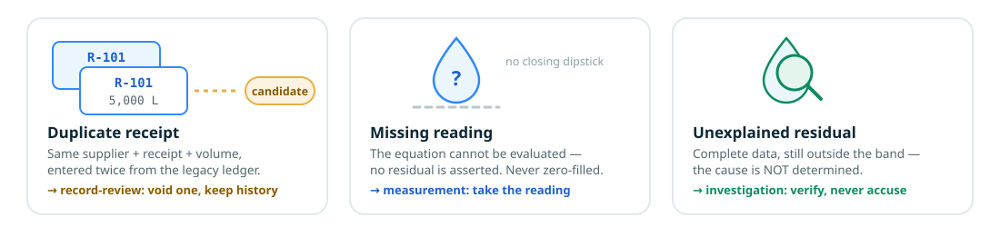</div>

---

## ⚖️ The Equation — with honest uncertainty

For one tank and one fully covered period, JalLekha computes one equation — and, critically,
**an uncertainty interval around it** built from the *declared* measurement bounds of every input.

<div align="center"></div>

```text
R = O + D − U − C          (opening + deliveries − metered usage − closing)

R_min = O_min + D_min − U_max − C_max
R_max = O_max + D_max − U_min − C_min      ← conservative SUM, never a statistical guess
```

The verdict is then staged, never exaggerated:

| Status | Meaning |
| --- | --- |
| **within uncertainty** | The imbalance is consistent with measurement error. *Not* "perfect balance". |
| **outside uncertainty** | Larger than declared error can explain → investigation opened. |
| **incomplete** | A required reading is absent → **no residual asserted at all**. |
| **invalid** | Impossible input → blocked, never clamped. |

> **A discrepancy is never worded as theft, leakage, or any cause.**
> JalLekha raises questions with evidence — people draw conclusions.

---

## 🖥️ Every screen, live

> Every screenshot is the **real running app** with synthetic demonstration data.

### 📊 Dashboard — the whole engine in one view
Hand-built SVG charts (zero charting dependencies): balance waterfall, cumulative meter trend
with delivery markers, deliveries by day, findings donut, measurement quality, residual band
across runs, and a live tank gauge. Plus anomaly flags and a demand forecast.

| 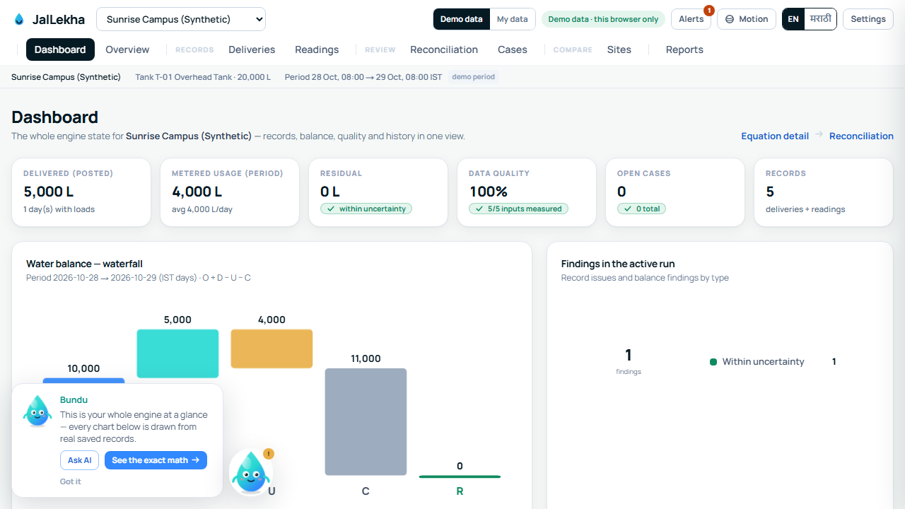 |
| --- |
| *Six KPI tiles: delivered, usage, residual, quality %, open cases, records.* |
| 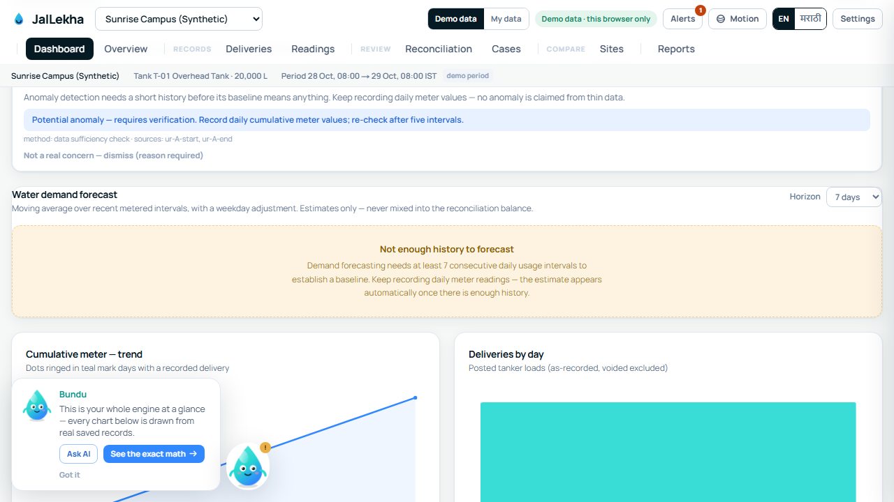 |
| *Waterfall, findings donut, meter trend, quality bar — all from persisted records.* |

### 📖 Overview — the equation, live
The selected site's state: equation card with residual verdict, uncertainty interval,
tank cutaway, and the findings the run produced.

| 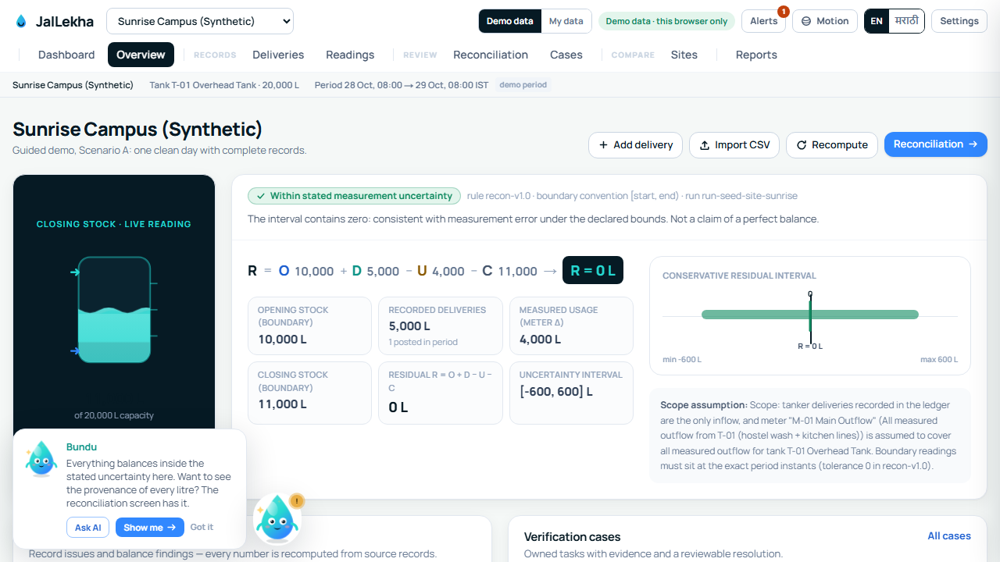 |
| --- |
| *Scenario B: R = +5,000 L — outside [4,300, 5,700] — duplicate candidate already linked.* |

### 📋 Deliveries — the ledger with a conscience
Search, filter, sort; manual entry; **validate-before-commit** CSV import; and an
**AI receipt scanner**. Duplicate candidates are *pills on the rows*, not delete buttons.

| 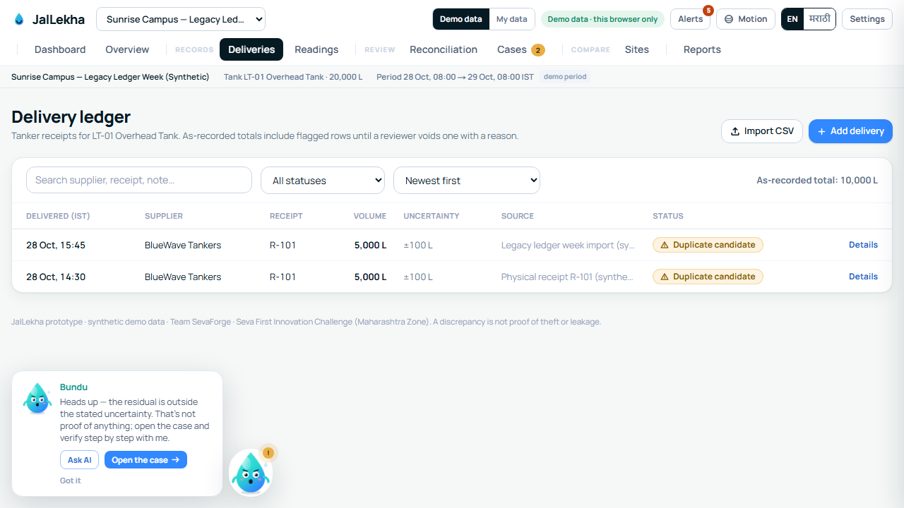 |
| --- |
| *Both R-101 rows visible until a reviewer voids one — with a documented reason.* |

### 📏 Readings — with IoT smart device integration
Tank and cumulative meter readings with declared uncertainty and quality labels.
IoT devices feed readings through **sensor-quality checks** into a pending queue
that requires **operator verification** before entering the ledger.

| 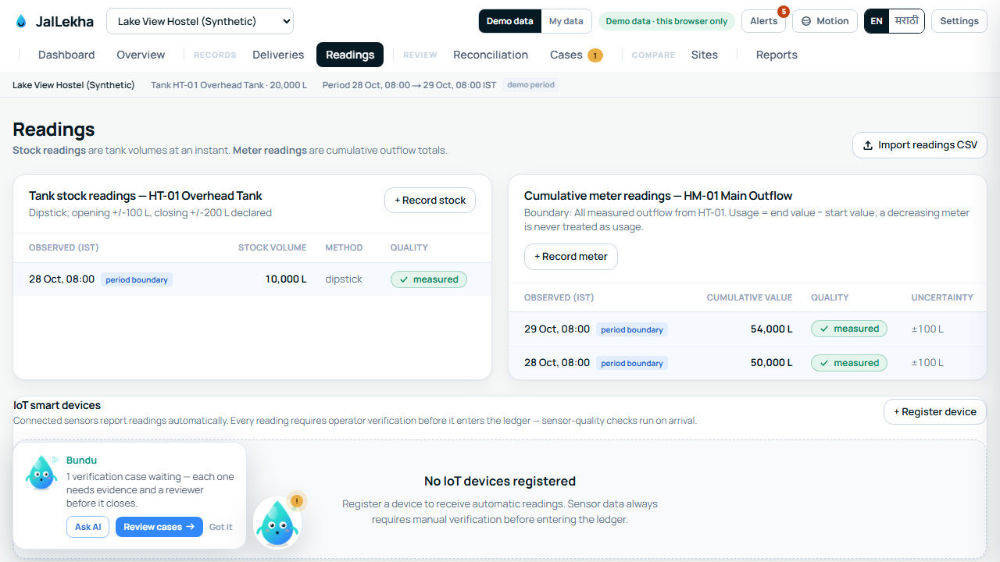 |
| --- |
| *Scenario C: no closing reading → residual unavailable → missing field named.* |

### ⚖️ Reconciliation — the run, explained
Status precedence, source-by-source provenance, the conservative interval, a rule-based
explanation, and **run history** — corrections create *superseding* runs.

| 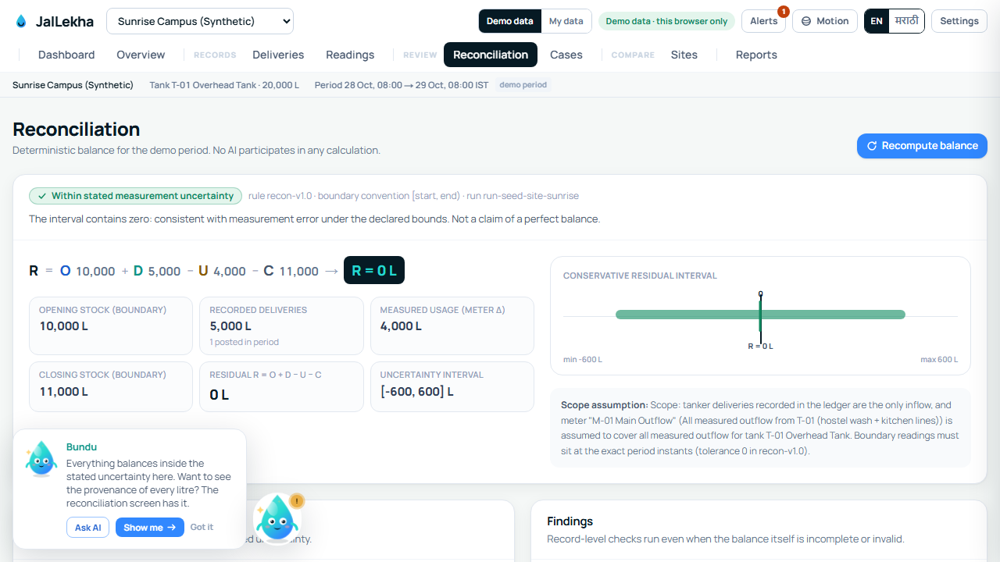 |
| --- |
| *Scenario B: outside uncertainty, cause not determined — scope assumption printed.* |
| 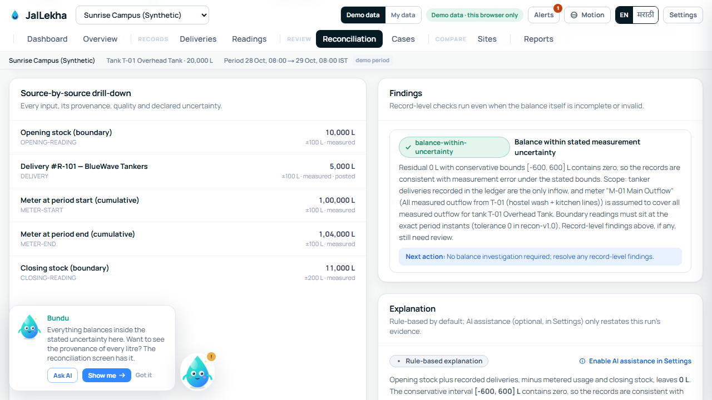 |
| *Uncertainty band and residual — the comparison that matters is zero-in-interval.* |

### 📁 Cases — findings become owned, evidence-backed work
Actionable findings open investigations exactly once. Each case has an assignee, status
transitions, evidence timeline, and resolution requiring **outcome + explanation + reviewer**.

| 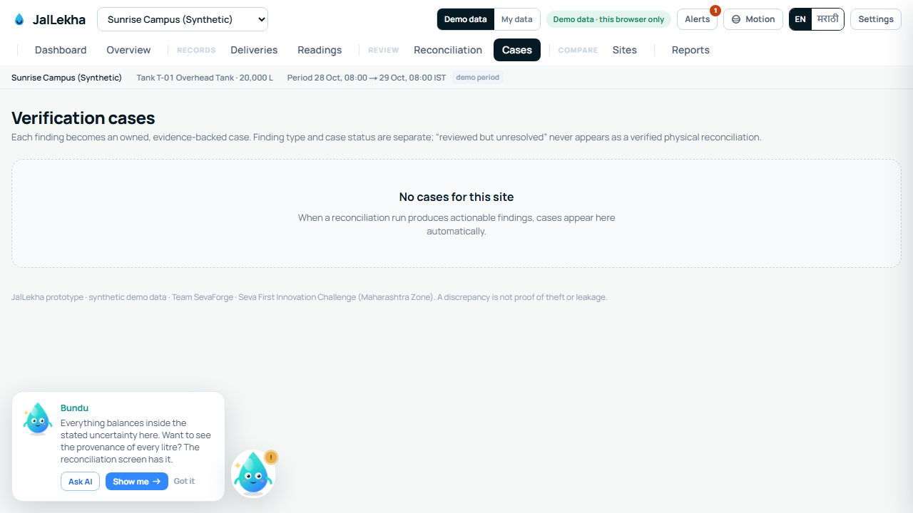 |
| --- |
| *Open cases with their next actions — evidence timeline inside each one.* |

### 🌐 Multi-Site — compare without misleading
Side-by-side reconciliation across every site. Comparison **reliability is explicit**:
sites with incomplete runs are marked "not comparable" instead of ranked.

| 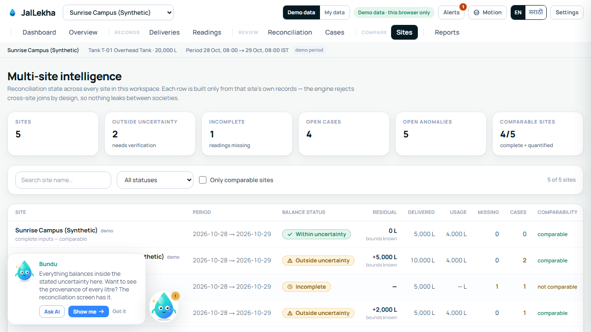 |
| --- |
| *Three sites compared: Alpha (comparable), Beta (not comparable — incomplete), Gamma (comparable).* |

### 📄 Reports — the documented review
Printable review that reads correctly **without color or animation**, safe CSV, JSON review,
and full workspace JSON export/restore.

| 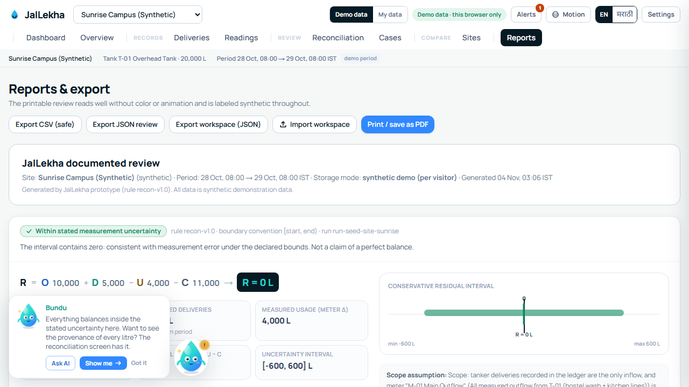 |
| --- |
| *Cases & outcomes, delivery history with voids and reasons, audit trail.* |

### 🔔 Notifications — nothing gets missed
Derived from real workspace state: missing readings, duplicates, unresolved discrepancies,
open investigations, and anomalies. Severity-tagged with direct links. Snooze or dismiss
with a recorded reason.

| 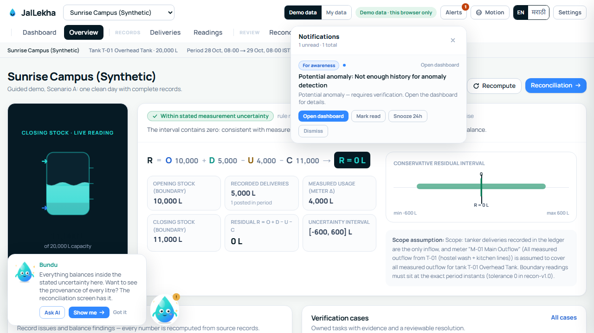 |
| --- |
| *Bell with unread badge; drawer with severity-tagged actionable items.* |

### 📷 AI Receipt Scanner — photo to record, with review
Upload a receipt photo → the vision model drafts the fields → you review and confirm.
Duplicates flagged against posted receipts. The original extraction is preserved in the audit note.

| 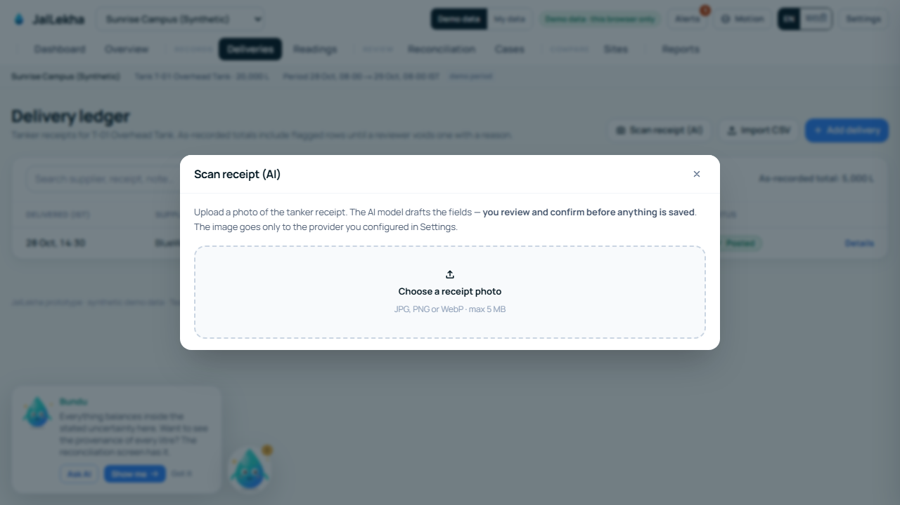 |
| --- |
| *Upload → extract → review extracted vs corrected values → confirm.* |

---

## 🔬 The four signature scenarios

| Scenario | Inputs | Expected outcome | Status |
| --- | --- | --- | --- |
| **A Baseline** | O 10,000 · D 5,000 · U 4,000 · C 11,000 | **R = 0 L** in [−600, +600] | ✅ within uncertainty |
| **B Duplicate** | Same + posted copy of R-101 | **R = +5,000 L** in [4,300, 5,700] | ⚠️ → after void: **R = 0 L** |
| **C Missing** | No closing reading | **No residual asserted** | ⏸ → after 11,000 L: **R = 0 L** |
| **D Unexplained** | O 10,000 · D 5,000 · U 4,000 · C 9,000 | **R = +2,000 L** in [1,400, 2,600] | ⚠️ → cause NOT determined |

---

## ✨ Feature deep-dive

### Deterministic engine (`src/domain` — pure TypeScript)
Framework-free, dependency-free. Boundary stock at **exact period instants** (tolerance 0);
flows in `[start, end)`; units convert exactly (1 kL = 1,000 L = 1 m³); NaN/∞/negatives/over-capacity
**rejected, never clamped**; negative meter deltas are invalid findings, never absolute-valued;
cross-site records refused. Pure = all tests run in Node in under a second.

### Anomaly detection — transparent, never accusatory
Moving-average deviations, meter jumps vs median factor, repeated discrepancies across runs,
and reporting gaps. Per-site thresholds stored in workspace config. Dismissals require a
recorded reason. Dual-lens: one interval can fire both a meter-pair anomaly and a consumption
deviation. Every anomaly is labeled **"potential anomaly — requires verification"**.

### Conservative uncertainty, by design
Input bounds are **declared** and combined by *conservative summation*. Unknown bounds make
the run **provisional** with no interval. Wider bounds don't prove better measurement. The
comparison that matters: **does zero lie inside the residual interval?**

### CSV import + receipt scanning you can trust
Quote-aware CSV parser (no `eval`), explicit date-format selection — ambiguous dates **rejected**.
AI receipt scanner: photo → vision model → review screen → operator confirms. Original extraction
preserved in the audit note. Duplicate receipts flagged against posted records.

### IoT smart meter integration — sensor quality checked, human verified
Devices register per tank/meter with calibration offsets. Raw readings pass sensor-quality checks
(capacity bounds, delta plausibility, staleness) then require **operator verification** before
entering the ledger. The device never writes directly to the reconciliation input.

### Demand forecasting — labeled estimates only
Moving-average baseline with optional weekday adjustment. Sufficiency gate: fewer than 7
intervals → data-availability warning, not a guess. Every forecast carries its method, input
range, assumptions, and the label **"Forecast estimate — not a measured water quantity"**.
Never mixed into the reconciliation balance.

### Notification center — nothing gets missed
Derived from real workspace state: missing readings, duplicate candidates, unresolved
discrepancies, open/stale investigations, and anomalies. Stable dedupe keys. Per-notification
read/snooze/dismiss state persisted. Header bell with unread count.

### Marathi + English interface — your language, your data
Persisted language switcher (EN | मराठी). Typed locale tables covering navigation, header,
dashboard, notifications and footer. **Data-language separation**: stored records and operator
notes keep their original language.

### Multi-site intelligence — compare without misleading
Side-by-side reconciliation across every site. Comparison **reliability is explicit**: sites
with incomplete runs or unquantified uncertainty are marked "not comparable" instead of ranked.

### Real data mode ("My data") — bring your own site
First-run onboarding creates your site, tank and meter. Import deliveries and readings from
CSV. Set the reconciliation period from the context strip. JSON export/import for backup.
Real records live in **their own storage key**, separate from the demo.

### 🤖 AI assistance — optional, provider-neutral, off by default
The engine **never** depends on AI. Features: finding explanation, note→fields drafting,
grounded Q&A chat (Ask Bundu), and receipt scanning. Provider-neutral: any OpenAI-compatible
endpoint or Anthropic's API. Keys stay in your browser. See [docs/AI.md](docs/AI.md).

### 🐌 Bundu — the workspace guide
A reactive droplet mascot on every screen: blinks, bobs, celebrates resolved cases, flags
discrepancies, and offers the next best action. All stilled by reduce-motion.

### Honest status, printed on the product itself
*Synthetic demonstration data; per-browser storage; prototype stage; no water savings claimed;
a discrepancy is not proof of theft or leakage.*

---

## 🏗️ Architecture

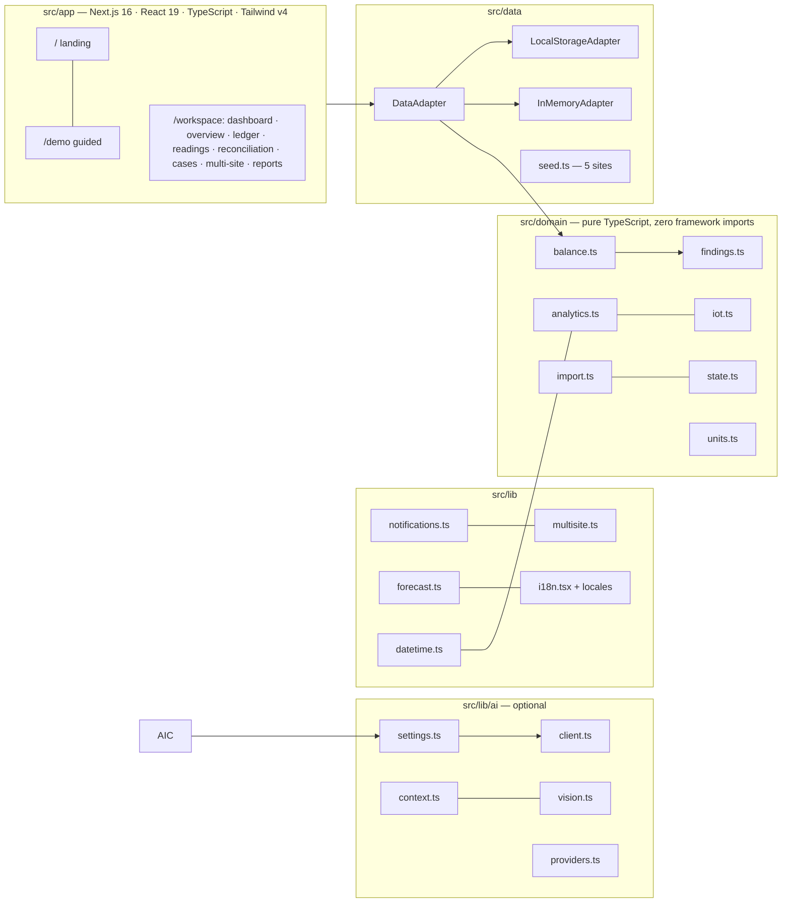

- **Engine purity**: the same `src/domain` code runs in Node tests today and in a future
  server-side multi-user backend unchanged.
- **Adapter pattern**: shared persistence is a drop-in implementation of one interface.
- **Deployment**: Next.js server build on Vercel (canonical) + static export mirror.
- **No heavy dependencies**: charts, tanks, mascots — hand-built SVG/CSS.

## ✅ Quality gates

| Gate | Result | What it protects |
| --- | --- | --- |
| `npm test` — Vitest | **97/97** | 4 signature scenarios to the litre, duplicate policy, units, import idempotency, reading conflicts, anomaly detection, notification derivation, multi-site aggregation, forecast separation, i18n parity, receipt scanning, IoT ingestion, AI config |
| Playwright e2e | **33/33**, zero console errors | Real user journeys: void → recompute → history, missing-reading completion, import replay, refresh persistence, dashboard rendering |
| `npm run typecheck` | **0 errors** | Strict TypeScript |
| `npm run lint` | **0 errors, 0 warnings** | ESLint across app and domain |
| `npm run preflight` | **green, 128 files** | Privacy gate: no private material tracked |

Full dated run log in [docs/VALIDATION.md](docs/VALIDATION.md). Limitations stated plainly:
**synthetic data only, no field pilot, no measured savings**.

## 🚀 Run it locally

```bash
npm install
npm run dev            # http://localhost:3000

npm test               # 97 tests
npm run typecheck      # 0 errors
npm run lint           # 0 errors, 0 warnings
npm run build          # production build
npm run build:static   # static export -> out/

npx playwright install chromium
node tests/e2e/journeys.spec.mjs http://127.0.0.1:3000
```

**Configuration (optional):** See [.env.example](.env.example) for AI proxy variables.
The in-app AI uses the operator's own key from Settings — no server config needed for the demo.

## 🗺️ Roadmap

Shared multi-user workspaces (Postgres + RLS behind the adapter) · human-factors evaluation ·
permissioned pilot kit · per-site reading tolerance · Marathi deep form-label coverage · CI badge ·
IoT transport layer (MQTT/webhook) · PDF receipt scanning. **Deferred**: ML forecasting, municipal
integrations, blockchain, native mobile — none makes one campus's records trustworthy before the
first pilot does.

## 👥 Team SevaForge

<div align="center"></div>

| | | | |
|:---:|:---:|:---:|:---:|
| **Arya Jannawar** | **Siddhant Pardeshi** | **Avani Jannawar** | **Vijay Sahu** |
| Team Lead | Quality & User Workflow | Engineering & Data Integrity | Research & Validation |
| Product & the reconciliation domain | Test gates, e2e journeys, operator screens | Repository owner — engine, CSV pipeline, data adapters | Field methods, measurement uncertainty, evidence trail |

---

## 🎬 How it all connects

<div align="center"></div>

<div align="center"></div>

---

<div align="center">


<br>

<a href="https://github.com/Avani376/jallekha/blob/main/docs/media/jallekha-feature-walkthrough.mp4">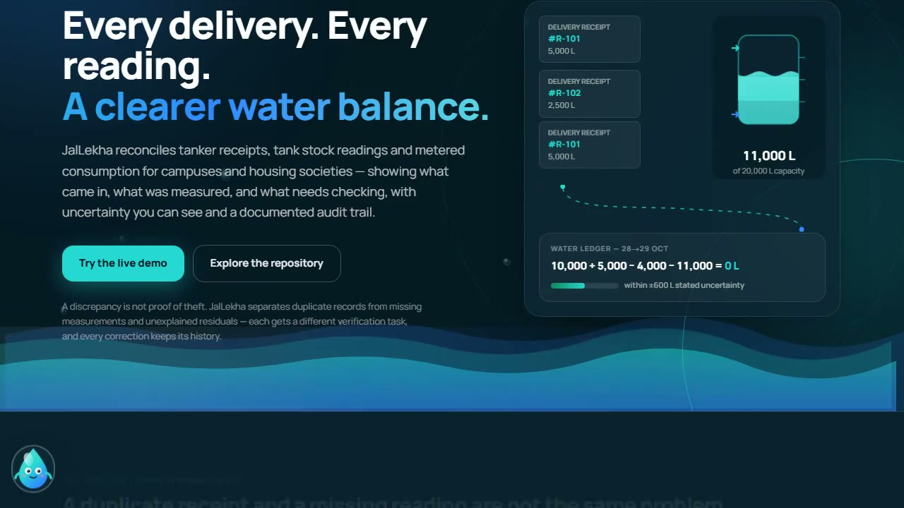</a>

**[▶ Watch the full feature walkthrough — 15 min](https://github.com/Avani376/jallekha/blob/main/docs/media/jallekha-feature-walkthrough.mp4) · [6-minute quick tour](https://github.com/Avani376/jallekha/blob/main/docs/media/jallekha-walkthrough.mp4)**

**[Open the live demo](https://jallekha.vercel.app/demo) · [Explore the workspace](https://jallekha.vercel.app/workspace)**

*JalLekha — prototype; synthetic demonstration data; no water savings claimed.*
*All suppliers, receipts, people and numbers in this repository are synthetic.*

</div>
