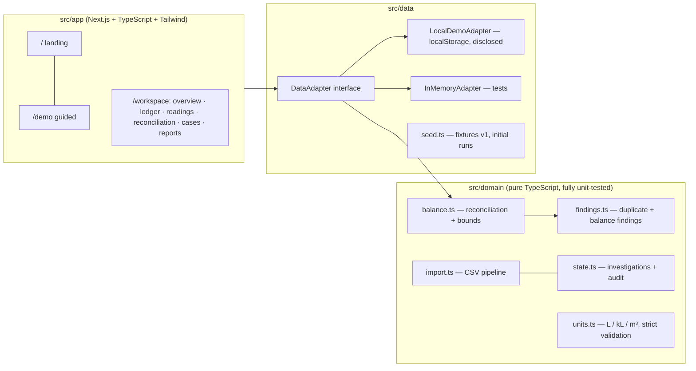

<div align="center">

# JalLekha

**Water delivery & consumption reconciliation for campuses and housing societies.**

*Know what came in, what was measured, and what needs checking.*

[Live Demo](https://jallekha-na41.zai-ai.site/demo) · [Landing page](https://jallekha-na41.zai-ai.site) · [Architecture](docs/ARCHITECTURE.md) · [Validation](docs/VALIDATION.md)

**Prototype by Team SevaForge — Seva First Innovation Challenge, Maharashtra Zone 2026**

</div>

---

### ⚠️ Honest status

This is a **working prototype validated on synthetic data only**. There is no field pilot, no
measured water savings, and no live AI in this build. The public demo stores data **per-visitor in
your browser** — it is not a shared server. A discrepancy is **not proof of theft or leakage**.

| What works | Evidence |
| --- | --- |
| Deterministic reconciliation with conservative uncertainty bounds | `recon-v1.0` rule engine, `src/domain/balance.ts` |
| 4 signature scenarios computed exactly as specified | Baseline **0 L** in `[-600, +600]` · Duplicate **+5,000 L** in `[4,300, 5,700]` → **0 L** after reviewed void · Missing reading → *no residual* · Unexplained **+2,000 L** in `[1,400, 2,600]` |
| 38 automated domain tests (Vitest) | `npm test` → **38/38 passing** |
| 27 browser e2e checks (Playwright) | `node tests/e2e/journeys.spec.mjs` → **27/27 passing** |
| Duplicate vs missing-reading → different next actions | Guided demo, both journeys scripted |
| CSV import with validate-before-commit preview, idempotent replay | Same file twice never doubles totals |
| Corrections that preserve history + audit trail + superseded runs | Every mutation is an audit event |
| Printable documented review + safe CSV/JSON export | Reports screen |

## The problem

Tanker receipts, tank dipstick readings and meter logs live in separate registers. When water
doesn't add up, staff trace entries by hand — and can't easily tell a **duplicate receipt** (needs a
record correction) from a **missing reading** (needs a measurement) from an **unexplained residual**
(needs investigation). JalLekha separates these, shows the uncertainty behind every number, and
turns findings into owned, evidence-backed cases.

## The equation

For one tank and one fully covered period, with boundary stock readings and in-period flows:

```
R = O + D − U − C          (O/C stock at instants; D/U flows in [start, end))

R_min = O_min + D_min − U_max − C_max      (conservative, no root-sum-square)
R_max = O_max + D_max − U_min − C_min
```

Status precedence: `invalid → incomplete (no residual asserted) → uncertainty not quantified →
within uncertainty → discrepancy`. A discrepancy is never labelled as theft, leakage or any cause.

## Two-minute tour

1. Open the [guided demo](https://jallekha-na41.zai-ai.site/demo) — four pre-loaded synthetic sites.
2. **Baseline**: the balance closes at 0 L within the stated interval.
3. **Legacy ledger week**: a double-entered receipt produces `R = +5,000 L` and a duplicate
   candidate linked to both rows. Void it as a reviewer → the balance returns to 0 L, history kept.
4. **Lake View Hostel**: no closing reading → *no residual at all* — record the reading → complete.
5. **Hillcrest Academy**: complete data, residual outside uncertainty → investigation, cause open.
6. **Reports** → print/save the documented review as PDF, or export CSV/JSON.

## Architecture



**Key decisions:** pure domain layer (no framework imports) · decimal-safe liters with strict
validation (NaN/∞/negative/over-capacity rejected, never clamped) · exact boundary instants
(tolerance 0) · conservative summed uncertainty (documented, not RSS) · content-derived stable
finding IDs · adapter pattern keeps a future shared backend (e.g. Supabase + RLS) drop-in.
Details in [docs/ARCHITECTURE.md](docs/ARCHITECTURE.md).

## Quick start

```bash
# Node LTS (tested on v24.15.0, npm 11.12.1)
npm install
npm run dev            # http://localhost:3000

npm test               # 38 domain tests
npm run typecheck      # tsc --noEmit
npm run lint           # eslint
npm run build          # production build (server mode)

# Static export (used for the public demo; fully client-side)
npm run build:static   # -> out/ (runs scripts/fix-static-prefetch.mjs)

# Browser e2e against a running build (default port 3000)
npx playwright install chromium
node tests/e2e/journeys.spec.mjs http://127.0.0.1:3000
```

Environment variables (none required for the demo): see `.env.example`
(`AI_MODE`, `ZAI_API_KEY`, `ZAI_MODEL`, `ZAI_BASE_URL` — server-only, disabled by default).

## Validation

See **[docs/VALIDATION.md](docs/VALIDATION.md)** for the dated run log (commands, environment,
fixture counts, outcomes and limitations). Test fixtures are internal technical validation —
**not a field pilot and not proof of liters saved**.

## Limitations

- Synthetic data only; no operator interviews or field evidence yet.
- Browser-local demo storage (per visitor); shared authenticated mode is designed but not enabled.
- Exact boundary readings required (`recon-v1.0`, tolerance 0); no reading substitution.
- Single-meter scope assumption is displayed on every result.
- No live AI in this build; explanations are rule-based.

## Team

**SevaForge** — Arya Jannawar (team lead) · Siddhant Santosh Pardeshi · Avni

Built for the Seva First Innovation Challenge (Maharashtra Zone) under
*Sustainability — Energy, Climate and Others*. All product data, suppliers, receipts and people in
this repository are synthetic. License: to be chosen by the team (no open-source license is
implied by publication without one).
