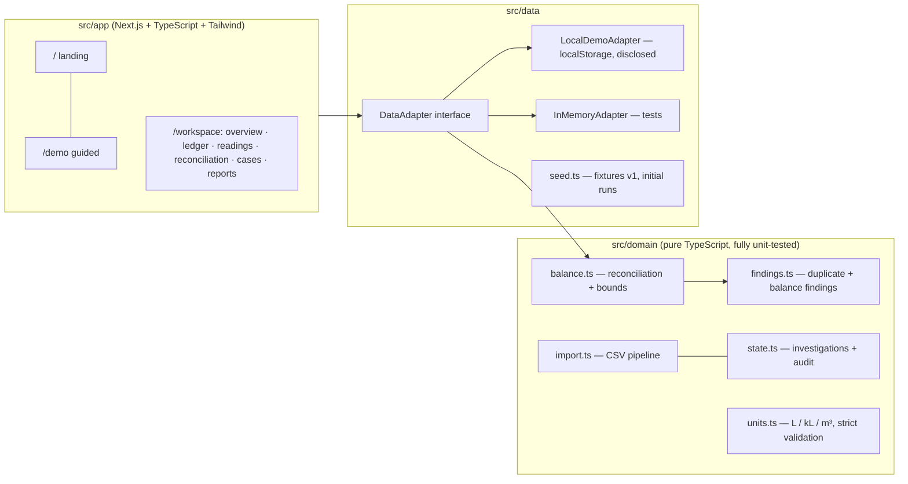

<div align="center">

# JalLekha

**Water delivery & consumption reconciliation for campuses and housing societies.**

*Know what came in, what was measured, and what needs checking.*

[Live Demo](https://jallekha-yp7u.zai-ai.site/demo) · [Landing page](https://jallekha-yp7u.zai-ai.site) · [Architecture](docs/ARCHITECTURE.md) · [Validation](docs/VALIDATION.md)

**Prototype by Team SevaForge — Seva First Innovation Challenge, Maharashtra Zone 2026**

</div>

---

### ⚠️ Honest status

This is a **working prototype validated on synthetic data only**. There is no field pilot, no
measured water savings, and no live AI in this build. The public demo stores data **per-visitor in
your browser** — it is not a shared server. A discrepancy is **not proof of theft or leakage**.

| What works | Evidence |
| --- | --- |
| Deterministic reconciliation with conservative uncertainty bounds | `recon-v1.0` rule engine, `src/domain/balance.ts` |
| 4 signature scenarios computed exactly as specified | Baseline **0 L** in `[-600, +600]` · Duplicate **+5,000 L** in `[4,300, 5,700]` → **0 L** after reviewed void · Missing reading → *no residual* · Unexplained **+2,000 L** in `[1,400, 2,600]` |
| 41 automated domain tests (Vitest) | `npm test` → **41/41 passing** |
| 33 browser e2e checks (Playwright) | `node tests/e2e/journeys.spec.mjs` → **33/33 passing** |
| Duplicate vs missing-reading → different next actions | Guided demo, both journeys scripted |
| CSV import with validate-before-commit preview, idempotent replay | Same file twice never doubles totals |
| Corrections that preserve history + audit trail + superseded runs | Every mutation is an audit event |
| Printable documented review + safe CSV/JSON export | Reports screen |
| **Dashboard** with authored SVG charts: balance waterfall, cumulative meter trend with delivery markers, deliveries by day, findings donut, measurement-quality mix, residual-across-runs band, tank gauge | `src/components/charts.tsx`, zero chart dependencies |
| **Bring your own data**: a real-data workspace (own site/tank/meter, own reconciliation period), readings + deliveries CSV import, JSON workspace backup/restore | "My data" mode in the app |
| **Bring your own AI key**: AI-assisted finding explanation and note→fields drafting (schema-validated, rule-based fallback) | Settings → AI assistance |
| **Ask Bundu** — grounded Q&A chat over your records: answers cite the exact receipt/reading IDs, suggest follow-ups, and never invent numbers | `src/components/ai/ask-panel.tsx`, `src/lib/ai/context.ts` |
| **Bundu the mascot** — a reactive droplet guide: blinks, bobs, celebrates closures, flags discrepancies, and offers the next best action on every screen | `src/components/mascot.tsx` |
| **Animated charts** — bars grow, lines draw, donuts sweep, gauges sweep; all stilled by the reduce-motion control | `src/components/charts.tsx`, `src/app/globals.css` |
| **Landing water experience** — layered swell, rising bubbles, drifting droplets, sonar ripples and a flow ribbon; CSS-only, ambient, and settled to a clean static state by the reduce-motion control | `src/app/page.tsx`, `src/app/globals.css` |
| **SevaForge team stage** — the team mark on deep water (rotating halo, orbiting droplets, shine sweep masked to the artwork) above the four-member roster | `src/app/page.tsx`, `public/brand/sevaforge-mark.png` |

## The problem

Tanker receipts, tank dipstick readings and meter logs live in separate registers. When water
doesn't add up, staff trace entries by hand — and can't easily tell a **duplicate receipt** (needs a
record correction) from a **missing reading** (needs a measurement) from an **unexplained residual**
(needs investigation). JalLekha separates these, shows the uncertainty behind every number, and
turns findings into owned, evidence-backed cases.

## The equation

For one tank and one fully covered period, with boundary stock readings and in-period flows:

```
R = O + D − U − C          (O/C stock at instants; D/U flows in [start, end))

R_min = O_min + D_min − U_max − C_max      (conservative, no root-sum-square)
R_max = O_max + D_max − U_min − C_min
```

Status precedence: `invalid → incomplete (no residual asserted) → uncertainty not quantified →
within uncertainty → discrepancy`. A discrepancy is never labelled as theft, leakage or any cause.

## Two-minute tour

1. Open the [guided demo](https://jallekha-yp7u.zai-ai.site/demo) — four pre-loaded synthetic sites.
2. **Baseline**: the balance closes at 0 L within the stated interval.
3. **Legacy ledger week**: a double-entered receipt produces `R = +5,000 L` and a duplicate
   candidate linked to both rows. Void it as a reviewer → the balance returns to 0 L, history kept.
4. **Lake View Hostel**: no closing reading → *no residual at all* — record the reading → complete.
5. **Hillcrest Academy**: complete data, residual outside uncertainty → investigation, cause open.
6. **Reports** → print/save the documented review as PDF, or export CSV/JSON.

## Architecture



**Key decisions:** pure domain layer (no framework imports) · decimal-safe liters with strict
validation (NaN/∞/negative/over-capacity rejected, never clamped) · exact boundary instants
(tolerance 0) · conservative summed uncertainty (documented, not RSS) · content-derived stable
finding IDs · adapter pattern keeps a future shared backend (e.g. Supabase + RLS) drop-in.
Details in [docs/ARCHITECTURE.md](docs/ARCHITECTURE.md).

## Quick start

```bash
# Node LTS (tested on v24.15.0, npm 11.12.1)
npm install
npm run dev            # http://localhost:3000

npm test               # 41 domain tests
npm run typecheck      # tsc --noEmit
npm run lint           # eslint
npm run build          # production build (server mode)

# Static export (used for the public demo; fully client-side)
npm run build:static   # -> out/ (runs scripts/fix-static-prefetch.mjs)

# Browser e2e against a running build (default port 3000)
npx playwright install chromium
node tests/e2e/journeys.spec.mjs http://127.0.0.1:3000
```

Environment variables (none required for the demo): see `.env.example`
(`AI_MODE`, `ZAI_API_KEY`, `ZAI_MODEL`, `ZAI_BASE_URL` — server-only, disabled by default).

## Validation

See **[docs/VALIDATION.md](docs/VALIDATION.md)** for the dated run log (commands, environment,
fixture counts, outcomes and limitations). Test fixtures are internal technical validation —
**not a field pilot and not proof of liters saved**.

## Bundu, the workspace guide

Bundu (from *boond*, a drop of water) lives on every screen. The mascot
reacts to your clicks and to real workspace events — celebrating a resolved
case, sweating over an unexplained residual — and its speech bubble always
offers the next best action for where you are. Reduced motion stills every
animation; the guidance stays.

## Ask Bundu (grounded AI chat)

With a key configured, **Ask Bundu** answers questions about the open
workspace — deliveries, readings, the balance, cases — using a deterministic
snapshot of the records as its only source, citing record IDs, and offering
follow-up questions. Setup state is honest: without a key the drawer shows
exactly how to enable it.

## AI assistance (optional, bring your own key)

Settings → **AI assistance**: paste an API key for any OpenAI-compatible
endpoint (the Z.ai v4 base URL is the default). The key is stored **only in
your browser** and is sent directly to the provider you configure — never to
JalLekha servers, exports, or audit records. Two grounded features:

- **Explain with AI** (Reconciliation screen): the model restates the run's
  evidence; every number in the UI is still rendered from the domain result.
- **Draft fields from note** (Add delivery): an operator's raw note becomes
  draft fields with explicit warnings — deterministic validation still gates
  saving, and nothing is posted automatically.

Responses are schema-validated; on any failure (no key, network/CORS, auth,
timeout, malformed output) the rule-based explanation is shown with a visible
label. The engine never depends on AI. Hardening notes for shared
deployments: `docs/AI.md`.

## Real data

Switch the header toggle to **My data**. A first-run screen creates your
site, tank and meter; then import deliveries (ledger) and readings
(readings screen) from CSV — ambiguous dates rejected, unit conversion
exact (1 kL = 1,000 L = 1 m³), conflicting same-instant readings blocked
instead of overwritten. Set the reconciliation period from the context
strip. **Export workspace (JSON)** on Reports backs up or moves everything;
**Import workspace** restores it. Storage is per-browser (localStorage,
~5 MB) — a single-device pilot workspace, not a shared server.

## Limitations

- Synthetic data only; no operator interviews or field evidence yet.
- Browser-local demo storage (per visitor); shared authenticated mode is designed but not enabled.
- Exact boundary readings required (`recon-v1.0`, tolerance 0); no reading substitution.
- Single-meter scope assumption is displayed on every result.
- AI is opt-in with the operator's own key; the shipped default is rule-based only.

## Team

**SevaForge** — Arya Jannawar (team lead) · Avani Jannawar · Siddhant Santosh Pardeshi · Vijay Sahu

Built for the Seva First Innovation Challenge (Maharashtra Zone) under
*Sustainability — Energy, Climate and Others*. All product data, suppliers, receipts and people in
this repository are synthetic. License: to be chosen by the team (no open-source license is
implied by publication without one).
