<div align="center">


# JalLekha

### *jal* (water) · *lekha* (ledger) — **know what came in, what was measured, and what needs checking.**

**Water delivery & consumption reconciliation for campuses and housing societies.**

[](https://jallekha.vercel.app/demo)
[](docs/media/jallekha-walkthrough.mp4)
[](#-quality-gates)
[](#-quality-gates)
[](#-ai-assistance--optional-provider-neutral-off-by-default)
[](#honest-status-printed-on-the-product-itself)

**Seva First Innovation Challenge · Maharashtra Zone · Sector: Sustainability — Energy, Climate & Others**

<a href="docs/media/jallekha-walkthrough.mp4">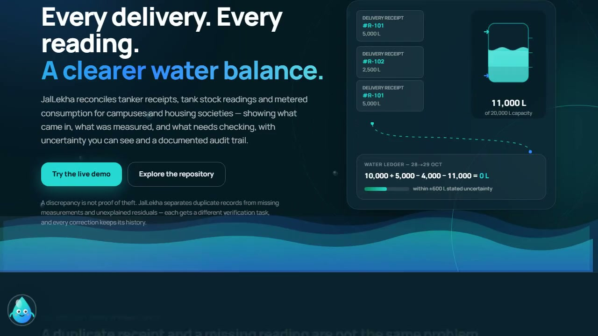</a>
<sub>▶ **Click the frame to watch the 6-minute narrated walkthrough** — the problem, all four scenarios performed live, every screen, and the team.</sub>

</div>

---

## 🌊 Why JalLekha exists

In campus and housing-society maintenance rooms, water arrives by **tanker**, gets stored in
**tanks**, and flows out through **meters** — and each of those is written down in a *different
place*: a pile of delivery receipts, a dipstick log taped to the tank, a cumulative meter register.
When the numbers don't agree, someone spreads three registers on a table and traces entries by hand.

Spreadsheets can total the numbers. They cannot tell you **why** they disagree — and the "why"
changes everything:

| What you found | What it actually is | What must happen |
| --- | --- | --- |
| The same receipt entered twice | A **record** problem | A reviewed correction that keeps history |
| A missing dipstick reading | A **measurement** gap | Someone goes and takes the reading |
| Everything recorded, still off | An **unexplained residual** | A careful, evidence-first investigation |

Mix these up and real damage follows: a duplicate gets called *theft*, a leak gets called
*bookkeeping*. JalLekha separates them mechanically, so the response always matches the cause.

<div align="center">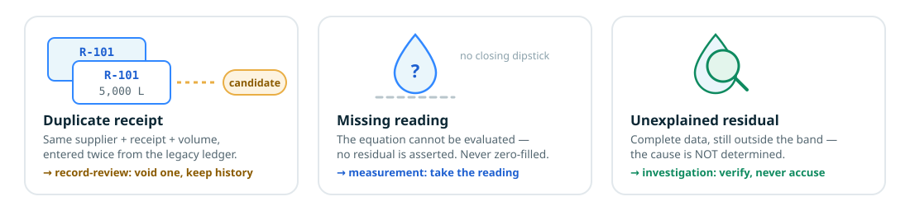</div>

---

## ⚖️ The honest math at the center

For one tank and one fully covered period, JalLekha computes one equation — and, critically,
**an uncertainty interval around it** built from the *declared* measurement bounds of every input:

```text
R = O + D − U − C          (opening + deliveries − metered usage − closing)

R_min = O_min + D_min − U_max − C_max
R_max = O_max + D_max − U_min − C_min      ← conservative SUM, never a statistical guess
```

The verdict is then staged, never exaggerated:

- **within uncertainty** → the imbalance is consistent with measurement error. *Not* "perfect balance".
- **outside uncertainty** → larger than declared error can explain → an investigation is opened.
- **incomplete** → a required reading is absent → **no residual is asserted at all** (never zero-filled, never borrowed).
- **invalid** → impossible input (negative meter delta, stock above capacity, cross-site record) → blocked, not clamped.

And one rule above all: **a discrepancy is never worded as theft, leakage, or any cause.**
JalLekha raises questions with evidence — people draw conclusions.

<div align="center"></div>

---

## 🧭 One workflow, visible end to end

<div align="center"></div>

## 🖥️ The product, tab by tab

> Every screenshot below is the **real running app** (synthetic demonstration data). Click any image to open the [live demo](https://jallekha.vercel.app/demo) at the same screen.

### ① Guided demo — four scenarios, three minutes, zero setup
The demo seeds four synthetic sites, each engineered to teach one lesson, and a scripted tour that
lands you directly inside the interesting one. Everything runs in *your* browser; nothing is uploaded.

| 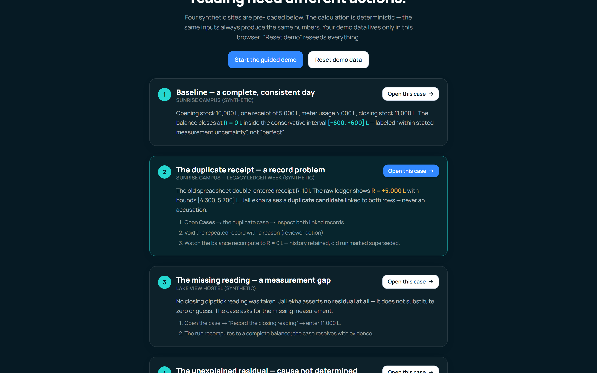 |
| --- |
| *Scenario cards with their expected outcomes printed up-front — the demo teaches before you click.* |

### ② Overview — the equation, live
The selected site's whole state on one screen: the equation card with the residual verdict, an
uncertainty interval figure, the tank cutaway, and the findings the run produced.

| 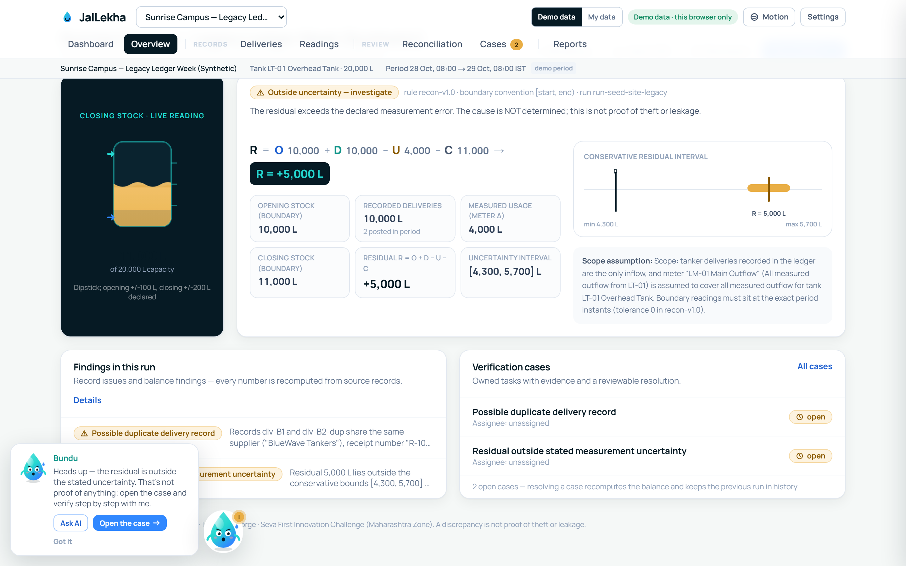 |
| --- |
| *Scenario B: the raw ledger shows R = +5,000 L — outside [4,300, 5,700] — with the duplicate candidate already linked.* |

### ③ Deliveries — the ledger with a conscience
Search, filter, sort; manual entry with deterministic validation; and a **validate-before-commit**
CSV import preview. Duplicate candidates are *pills on the rows*, not delete buttons.

| 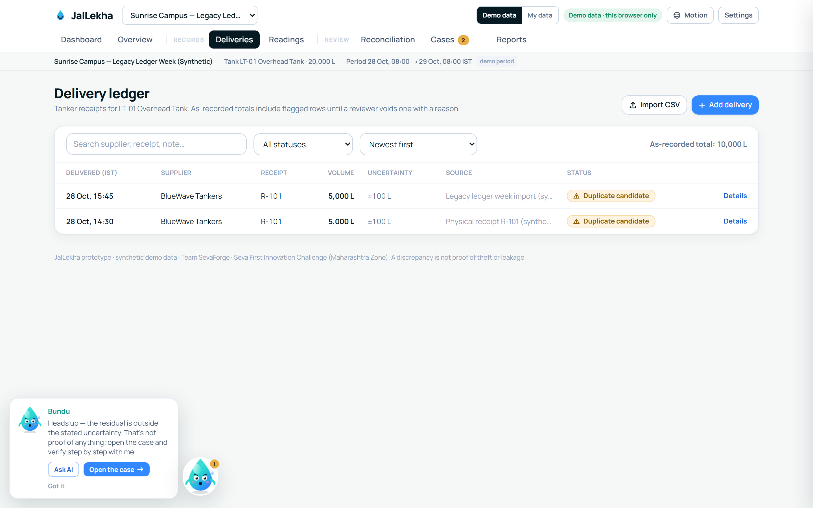 |
| --- |
| *Both R-101 rows stay visible and posted until a reviewer voids one — with a reason.* |

### ④ Readings — stock and meters, exactly at the boundary
Tank dipstick readings and cumulative meter readings with declared uncertainty and quality labels.
A decreasing meter delta is **invalid, never absolute-valued**; a missing boundary reading blocks the
balance instead of being guessed.

| 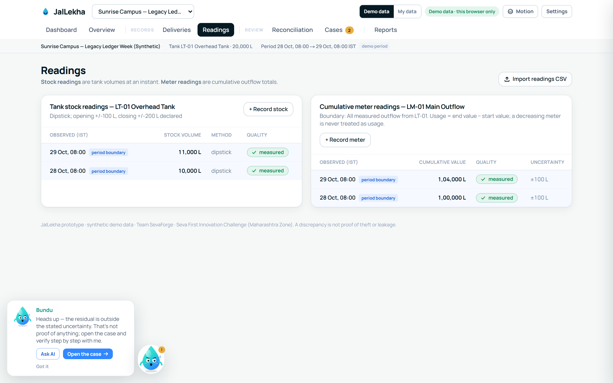 |
| --- |
| *Boundary instants are labelled; usage = end − start over the same meter and units.* |

### ⑤ Reconciliation — the run, explained
The full run: status precedence, source-by-source provenance for every input, the conservative
interval figure, a rule-based explanation, and **run history** — corrections create *superseding*
runs so a reviewer can always see what the ledger looked like *before* the correction.

| 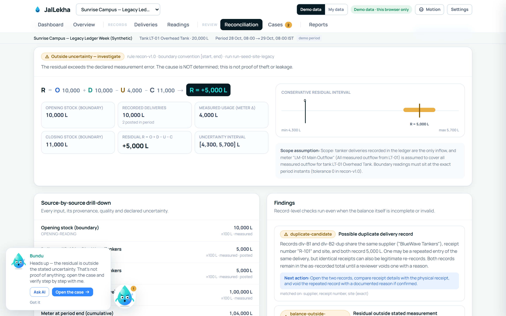 |
| --- |
| *Scenario B raw state: outside uncertainty, cause not determined — the scope assumption is printed on the result.* |

### ⑥ Cases — findings become owned, evidence-backed work
Actionable findings open investigations exactly once. Each case carries an assignee, explicit
status transitions (open → in review → action required → resolved), a timestamped evidence
timeline, and a resolution that requires **outcome + explanation + reviewer**. Voiding a duplicate
auto-resolves its case with the reason attached.

| 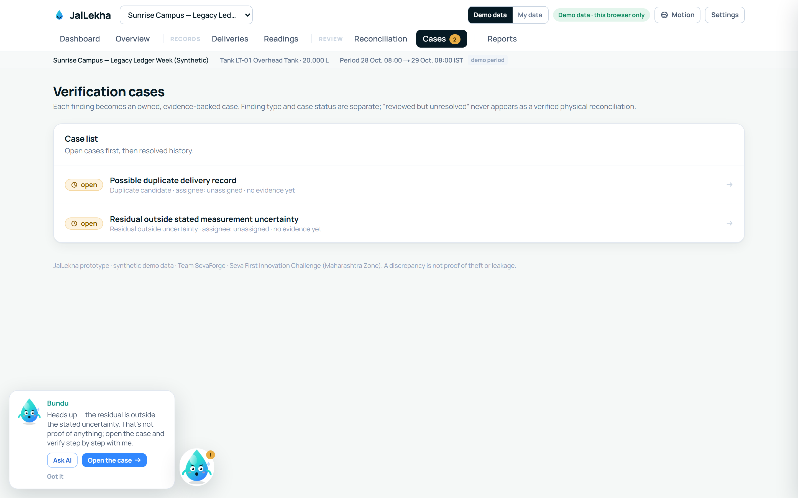 |
| --- |
| *Two open cases on the legacy-ledger week — each with its own suggested next action.* |

### ⑦ Dashboard — records become insight
Hand-built SVG charts (zero charting dependencies, all stilled by the reduce-motion control):
balance waterfall, cumulative meter trend with delivery markers, deliveries by day, findings mix,
measurement quality, residual band across runs, and a live tank gauge.

| 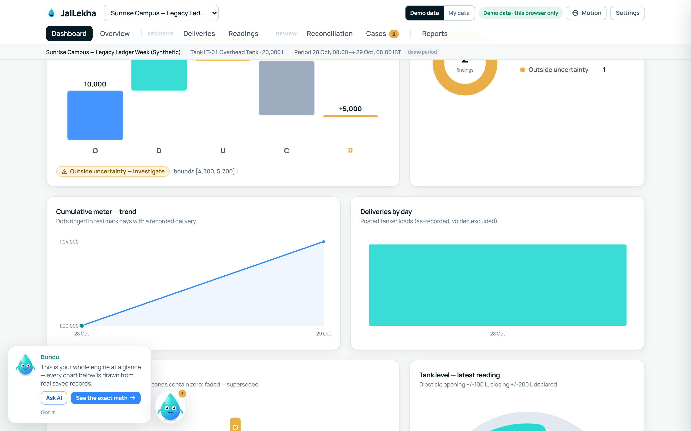 |
| --- |
| *KPIs and charts drawn from real stored records — nothing simulated.* |

### ⑧ Reports — the documented review
A printable documented review that reads correctly **without color or animation**, plus safe CSV
(formula prefixes neutralized), a JSON review, and a full workspace JSON export/restore for backup
and device moves.

| 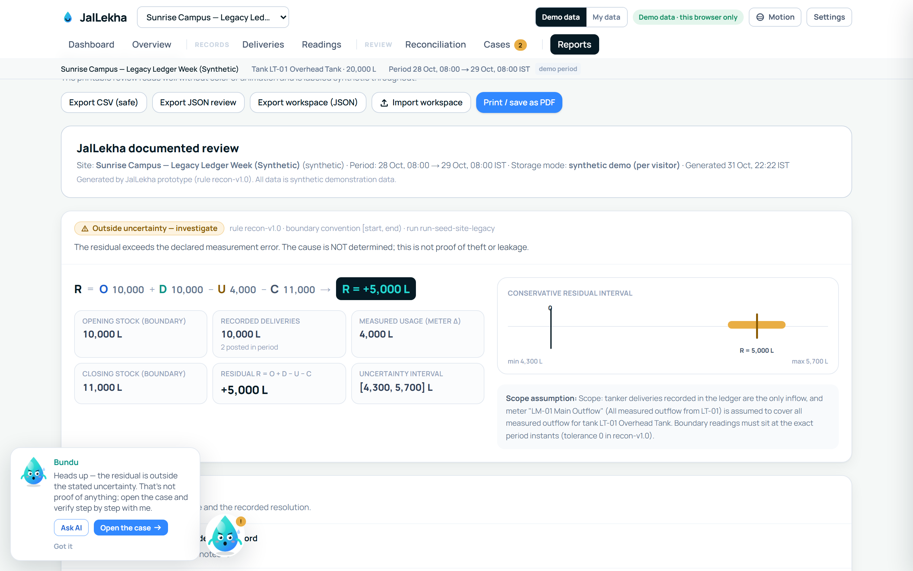 |
| --- |
| *Cases & outcomes, delivery history including voids with reasons, and the audit trail.* |

---

## 🔬 The four signature scenarios

The demo seed is engineered so each reconciliation outcome is asserted **to the litre** in the test
suite (`fixtures/synthetic/scenarios.ts`):

| Scenario | Inputs (synthetic) | Expected outcome | Status after |
| --- | --- | --- | --- |
| **A — Baseline** | O 10,000 ±100 · D 5,000 ±100 · U 4,000 (±100×2) · C 11,000 ±200 | **R = 0 L**, bounds [−600, +600] | ✅ within uncertainty |
| **B — Duplicate receipt** | legacy ledger double-enters receipt R-101 | **R = +5,000 L**, bounds [4,300, 5,700] → duplicate candidate | 🔍 discrepancy → after reviewed void: **R = 0 L**, history kept |
| **C — Missing reading** | no closing dipstick reading | **no residual asserted** — missing field is *named* | ⏸ incomplete → after recording 11,000 L: **R = 0 L** |
| **D — Unexplained** | O 10,000 · D 5,000 · U 4,000 · C 9,000 | **R = +2,000 L**, bounds [1,400, 2,600] | 🔍 discrepancy → investigation, **cause not determined** |

---

## ✨ Feature deep-dive

<div align="center"></div>

### Deterministic reconciliation engine (`src/domain` — pure TypeScript)
The engine is a framework-free, dependency-free layer: no React, no storage, no network. Boundary
stock must sit at the **exact period instants** (tolerance 0 in `recon-v1.0`); flows count only
inside `[start, end)`; units convert exactly (1 kL = 1,000 L = 1 m³); NaN/∞/negatives/over-capacity
are **rejected, never clamped**; negative meter deltas are invalid findings, never absolute-valued;
cross-site records are refused. Because it is pure, all 55 tests run in plain Node in under a second.

### Conservative uncertainty, by design
Input bounds are **declared** (±100 L dipstick, ±100 L receipt, meter ±100×2 for a delta) and
combined by *conservative summation* — inputs from the same operator are correlated, so root-sum-square
would understate the error. Unknown bounds make the run **provisional** with no interval asserted:
uncertainty is never invented and never hidden.

### Duplicate detection that never destroys anything
Exact matches (supplier + receipt + site) and fuzzy candidates (same supplier + volume within 24 h
with the receipt number missing) become **linked candidates**. A reviewer voids with a documented
reason; voided rows stay visible with their history; totals recompute; the old run is superseded —
the before-picture is always inspectable.

### CSV import you can trust
A manual, quote-aware CSV parser (no `eval`, output HTML-escaped), explicit date-format selection —
ambiguous `05/03/2026`-style dates are **rejected** rather than guessed — exact unit conversion,
row-level errors surfaced in a validate-before-commit preview, exact duplicates skipped, and
**content-derived idempotency keys**: replaying the same file posts nothing. Readings import blocks
a *different* value at an already-recorded instant instead of overwriting it.

### Owned cases + a complete audit trail
Content-derived stable finding IDs, idempotent investigation opening, ownership with assignees,
`assertTransition` status guardrails, evidence notes attributed and timestamped, resolutions that
require outcome + explanation + reviewer, and an audit event for **every** mutation.

### Real data mode ("My data") — bring your own site
A first-run onboarding creates your site, tank and meter; then import your own deliveries and
readings from CSV and set the reconciliation period. Real records live in **their own storage key**,
separate from the demo; JSON export/import moves or backs them up. Demo and real workspaces can
never mix.

### 🤖 AI assistance — optional, provider-neutral, off by default
The engine **never** depends on AI. When an operator opts in, AI can (1) restate a run's evidence in
plain language and (2) draft fields from an operator's raw note — drafts only; deterministic
validation still gates every save. It is provider-neutral by design: any OpenAI-compatible endpoint
(OpenAI, Z.ai, self-hosted gateways) or Anthropic's declared API — **you** supply endpoint, key and
model from your own plan. Keys stay in your browser (or server env for shared deployments); the
model can only explain evidence from the run and can never invent a measurement. See
[docs/AI.md](docs/AI.md).

### Accessibility & motion discipline
A header control stills **every** animation app-wide (and OS-level reduced-motion is honored);
statuses are icon + label, never color alone; charts and the ambient water on the landing page all
settle to clean static states when motion is off.

### Honest status, printed on the product itself
The demo footer, the overview and the reports all state it: *synthetic demonstration data; per-browser
storage; prototype stage; no water savings claimed; a discrepancy is not proof of theft or leakage.*

---

## 🏗️ Architecture & technology stack

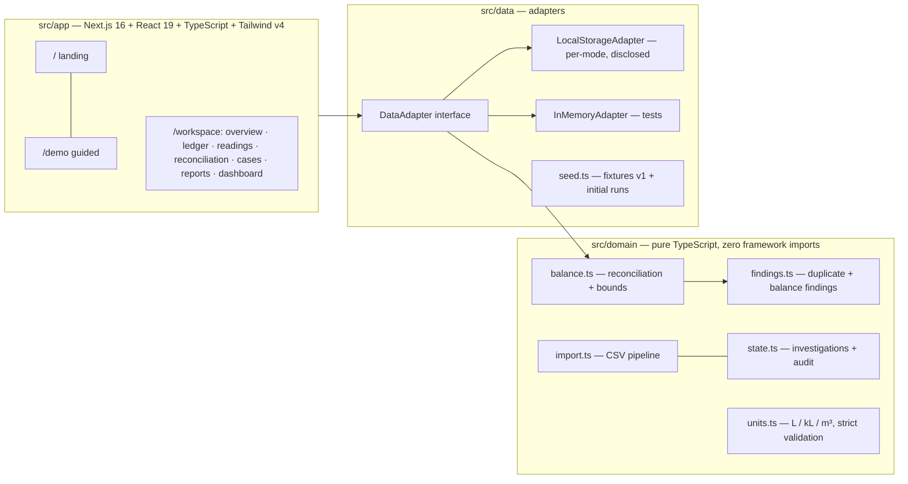

- **Engine purity** is the architecture: the same `src/domain` code runs in Node tests today and in
  a future server-side multi-user backend unchanged.
- **Adapter pattern** means shared persistence (e.g. Postgres + RLS) is a drop-in implementation of
  one interface — the UI never touches storage directly.
- **Deployment**: Next.js server build on [Vercel](https://jallekha.vercel.app) (canonical), plus a
  fully static export for air-gapped/low-cost hosting.
- **No heavy dependencies**: routing, validation (Zod) and CSS (Tailwind v4) only — charts, tanks,
  mascots and every animation on this page are hand-built SVG/CSS.

## ✅ Quality gates

| Gate | Result | What it protects |
| --- | --- | --- |
| `npm test` — Vitest | **55/55** | The four signature scenarios to the litre, duplicate policy, units, import idempotency, reading conflicts, AI config validation |
| `node tests/e2e/journeys.spec.mjs` — Playwright | **33/33**, zero console errors | The real user journeys: void → recompute → history, missing-reading completion, import replay, refresh persistence |
| `npm run typecheck` / `npm run lint` | **0 errors / 0 warnings** | Strict TypeScript + lint across app and domain |
| `npm run preflight` | **green, 86 files** | Privacy gate: internal project knowledge, private context and env files can never be tracked |

The full, dated run log lives in [docs/VALIDATION.md](docs/VALIDATION.md) — and its limitations are
stated as plainly as its results: **synthetic data only, no field pilot, no measured savings**. The
next milestone is a permissioned pilot at one campus or society.

## 🚀 Run it locally

```bash
# Node LTS (tested on v24.15.0, npm 11.12.1)
npm install
npm run dev            # http://localhost:3000

npm test               # 55 tests (41 domain + 14 AI-configuration)
npm run typecheck      # next typegen + tsc --noEmit
npm run lint           # eslint
npm run build          # production build (server mode)
npm run build:static   # static export -> out/ (what the public demo ships)

npx playwright install chromium
node tests/e2e/journeys.spec.mjs http://127.0.0.1:3000
```

**Configuration (optional — the demo needs none):** AI is off by default and provider-neutral.
Create a local `.env` (never committed):

```bash
AI_MODE=disabled          # disabled | live
AI_PROVIDER=              # openai | anthropic | zai | custom
AI_MODEL=                 # a model id verified under YOUR plan
AI_BASE_URL=              # optional override; REQUIRED for zai/custom
OPENAI_API_KEY=
ANTHROPIC_API_KEY=
ZAI_API_KEY=
```

`src/lib/ai/providers.ts` validates it server-side with clear errors. Full details in [docs/AI.md](docs/AI.md).

## 🗺️ Roadmap

Shared multi-user workspaces (Postgres + RLS behind the adapter) · human-factors evaluation with
real operators · a permissioned pilot kit (operator guide + CSV templates + uncertainty worksheet) ·
per-site reading tolerance · Marathi labels · CI badge. Deliberately **deferred**: OCR, IoT
ingestion, blockchain anything — none of it makes one campus's records trustworthy before the first
pilot does.

## 👥 Team SevaForge

<div align="center"></div>

| | | | |
|:---:|:---:|:---:|:---:|
| **Arya Jannawar** | **Siddhant Pardeshi** | **Avani Jannawar** | **Vijay Sahu** |
| Team Lead | Quality & User Workflow | Engineering & Data Integrity | Research & Validation |
| Product & the reconciliation domain — the problem, the math, the story | Test gates, e2e journeys and every operator-facing screen | Repository owner — engine, CSV pipeline, data adapters | Field methods, measurement uncertainty and the evidence trail |

---

<div align="center">


**[▶ Open the live demo](https://jallekha.vercel.app/demo) · [▶ Watch the walkthrough](docs/media/jallekha-walkthrough.mp4) · [Explore the workspace](https://jallekha.vercel.app/workspace)**

*JalLekha — prototype; synthetic demonstration data; no water savings claimed.*
*All suppliers, receipts, people and numbers in this repository are synthetic.*

</div>
